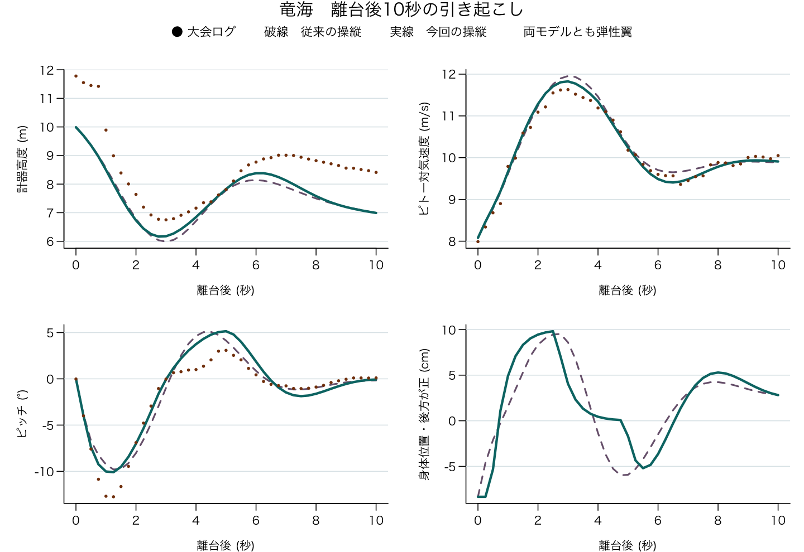

# 竜海の引き起こしで翼のたわみと体重移動を切り分ける

竜海の2025年大会ログに合わせ、離台直後の基準操縦を更新した。離台から0.4秒は助走時の前寄りの姿勢を保ち、2.6秒まで後方へ入力し、4.9秒まで中立に戻す。その後は従来の速度・昇降率・ピッチ角速度に応じた操縦に戻る。身体は最大0.30 m/s、前後各10 cmの範囲で動き、荷重と重心位置から機首の動きを解く。操縦時刻は今回の1飛行の引き起こしに合う候補値で、鳥科が測った操縦履歴ではない。手動飛行では離台直後からプレイヤーの入力を受け付ける。[飛行ログ](https://github.com/torica-org/25th_Analysis/blob/115723c24ce9e64c07c79215770acc7559518d42/flightDataPlot/src/2025_Tatsumi.csv)・[機体と大会記録](https://torica-tus.com/2025/11/14/2025/)

## 何が機首の反応を変えたか

風場、正面発進、離台速度8 m/s、初期ピッチ0°、ピッチ角速度−14°/s、初期重心位置（前方4 cm）を固定した。手動飛行のソルバーに①無入力、②離台0.4～2.6秒だけ後方へ最大入力、の2通りを与え、それぞれを剛体翼と弾性翼で飛ばした。いずれもラダーは中立。翼を変える対では身体位置の履歴が一致する。機体が進む距離に応じて同じ基準風場を評価するため、経路が分かれた後の対気速度は結果として変わる。

| 変えたもの | 比較条件 | 0～2秒のピッチの差 | 2～5秒のピッチの差 |
|---|---|---:|---:|
| 翼の弾性 | 後方入力を固定 | 0.32° | 0.49° |
| 翼の弾性 | 無入力を固定 | 0.18° | 0.47° |
| 後方入力の有無 | 弾性翼を固定 | 2.54° | 6.51° |
| 後方入力の有無 | 剛体翼を固定 | 2.69° | 6.41° |

数値は同時刻の試技間の差の二乗平均平方根。今回の入力幅では体重移動の方が機首の動きを大きく変える。弾性翼にも違いが出る。新しい基準操縦を固定して剛体から弾性翼にすると、引き起こしで機首が水平に戻る時刻は2.90秒から3.01秒になる。この比較では翼の曲げ・ねじりと、それに伴う空力の変化をまとめて切り替えた。実機ログには翼の変位や身体位置の時系列がなく、大会当日の寄与率は特定できない。

## 同じ大会ログとの照合

離台は機上時刻3.9秒。以後0.25秒刻みの41点で、機体の模擬計器高度をチーム補正後の気圧高度に、模擬ピトー速度を処理済み対気速度に、ピッチを符号をそろえた主IMUに照合した。ログは各時刻の前後0.25秒の中央値、モデルは同時刻のサンプル。全ケースで高度のオフセットも時刻のずらしも加えていない。[高度の基準と時刻合わせ](pullup-validation.md)

| 翼 | 基準操縦 | 高度RMSE (m) | 対気速度RMSE (m/s) | ピッチRMSE (°) |
|---|---|---:|---:|---:|
| 剛体 | 変更前 | 1.095 | 0.153 | 1.442 |
| 弾性 | 変更前 | 1.123 | 0.185 | 1.549 |
| 剛体 | 今回 | 1.047 | 0.123 | 1.360 |
| 弾性 | 今回 | 1.079 | 0.141 | 1.423 |

| 弾性翼の変化 | 実機 | 変更前 | 今回 |
|---|---:|---:|---:|
| 離台後2秒までの最低ピッチ | −12.75° | −9.80° | −10.09° |
| 機首が水平に戻る時刻 | 3.01秒 | 3.13秒 | 3.01秒 |
| 計器高度の谷の時刻 | 3.00秒 | 3.00秒 | 2.75秒 |
| 最初の高度の山の時刻 | 6.75秒 | 6.00秒 | 6.25秒 |
| 谷から山までの高度回復量 | 2.26 m | 2.15 m | 2.22 m |

**差が縮んだのは主に引き起こし中の2～5秒。** この区間では高度0.60→0.51 m、速度0.26→0.18 m/s、ピッチ2.22→1.76°と3項目とも改善した。0～2秒はピッチが1.92→1.58°に改善する一方、高度は1.54→1.58 m、速度は0.15→0.17 m/s。5～10秒は高度と速度が近づく一方、ピッチは0.41→1.09°に広がった。谷の時刻も1サンプル早い。全飛行の試算は420.95→421.09 mで、大会記録は433.02 mだった。

高度には特に測定基準の影響がある。離台時の模擬計器は9.99 m、チーム補正高度は11.78 m。比較先を生ログの機上推定高度に替えると10秒の高度RMSEは0.560→0.629 mとなった。いずれも同一飛行の照合で、風やピッチの取付角、身体移動を独立に測った試験ではない。[機上の生ログ](https://github.com/torica-org/25th_Analysis/blob/115723c24ce9e64c07c79215770acc7559518d42/getWindVector/src/2025FlightLog.csv)

離台の読み取り誤差も確かめた。鳥科ログの離台時刻だけを3.9秒から3.7秒、4.1秒に替え、同じ0.25秒窓で再集計した。高度と対気速度の10秒RMSEは両方の時刻で縮む。ピッチは4.1秒で1.982→1.781°だが、3.7秒では1.596→1.675°と逆転する。この同期精度では、水平復帰が実機と百分の一秒まで合ったとは言えない。

`node analysis/elastic-pullup.js` で比較表を再計算できる。`--csv` を付けるとログと全8試技の系列を出力する。図は `node analysis/elastic-pullup.js --csv | Rscript analysis/plot-elastic-pullup.R` で生成できる。
