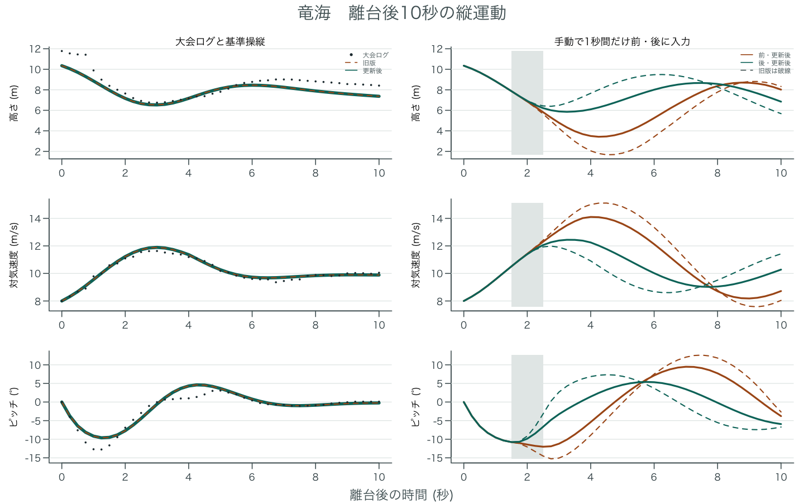

# 竜海の飛行モデルと2025年大会の照合

翼幅25.1 m・取付角3.2°の比較用基準機は **422.18 m・53.69秒**。大会の433.02 mより10.84 m短く、ログから推定した54.23秒より0.54秒早く接水した。同じ設計・同じ風で体重移動とラダーを中立にすると **308.03 m・32.68秒** で接水する。基準機には大会GPSから作ったコースと、機上ログを参照して調整した体重移動則を与えている。他の設計や操縦での予測精度を調べるには、独立した飛行の記録が要る。[鳥科の機体諸元と大会結果](https://torica-tus.com/2025/11/14/2025/)・[大会ログ](https://github.com/torica-org/25th_Analysis/blob/115723c24ce9e64c07c79215770acc7559518d42/flightDataPlot/src/2025_Tatsumi.csv)・[コースの構成](../src/domain/race2025.js)

## どの運動を再現したか

両モデルとも正面から標準押力で台端まで押し、基準風を使った。計器時刻3.9秒を離台と置く。0〜10秒の41時点について、各時点の前後0.25秒に入る大会CSVの中央値を計算し直し、収録済みの高度・対気速度・ピッチの全123値と照合した。主IMUのピッチは機首上げを正にそろえた。実機の初期高度は補正気圧高度で、モデルは機体底面の水面高を使う。離台時点の高さは計器11.78 m、モデル10.35 mで、1.43 mの差がある。[元データと高度の扱い](pullup-validation.md)・[再計算コード](../analysis/physics-audit.js)

| 指標 | 大会飛行 | 基準操縦 | 手動・無入力 |
|---|---:|---:|---:|
| 採点距離 | 433.02 m | 422.18 m | 308.03 m |
| 離台から接水 | 約54.23秒 | 53.69秒 | 32.68秒 |
| 0〜10秒の高さ RMSE | — | 0.819 m | 1.523 m |
| 離台時をゼロにした高さ変化の RMSE | — | 0.991 m | 0.813 m |
| 対気速度 RMSE | — | 0.164 m/s | 1.217 m/s |
| ピッチ RMSE | — | 1.442° | 4.613° |
| 離台7.1秒の高さ | 9.02 m | 8.21 m | 8.01 m |

基準機の最初の谷は実機と同じ離台3.00秒に来る。谷から8秒までの回復量は実機2.26 m、基準機1.92 mで、山は実機の6.75秒に対して6.00秒と早い。手動・無入力で高度変化の誤差だけが小さくても、速度とピッチまで再現できたことにはならない。41点は単一飛行の重なり合う中央値窓で、独立した41試行ではない。[引き起こしの時系列](../src/domain/pullup-data.js)・[RMSEと回復点の定義](../analysis/pullup-analysis.js)

## 体重移動でどれだけ機首が動くか

全備100 kgから空虚48 kgを引くと52 kg残る。今回は、装備とグリップで支えた部分に相当する4 kgを機体側に置き、残り48 kgが肩・胸・腰と一緒に前後に移ると仮定した。全機重心の移動は身体の変位の0.48倍である。後方を正とし、前後10 cmの身体移動で重心は前後4.8 cm動く。身体の最大移動速度は0.30 m/s、重心では0.144 m/s。離台時の旧来の設定（重心を4 cm前に置く）に対応して、台上から身体を8.33 cm前に寄せている。公表資料で確認できるのは機体質量で、個人の体重、支えの反力、実際の移動距離は不明である。[鳥科の機体諸元](https://torica-tus.com/2025/11/14/2025/)・[質量と可動域](../src/domain/pilot-shift.js)

後方に移ると、空気力の機体上向き成分と重心移動の積だけ機首上げモーメントが増す。前方なら符号が逆になる。基準操縦はこれまでの速度・昇降・角速度から求めた重心の指令を、必要な身体変位に変換してから機内の可動域で制限する。公開ログに体重移動の時系列がないため、操縦則を観測値に合わせ直す操作は加えていない。慣性と機体の座標原点を固定した近似であり、人体を急に動かした際の胴体への反作用は別途扱う必要がある。[飛行計算](../src/domain/aircraft-dynamics.js)

機内では目と胴体が同じ距離を移動し、肩と手首の間で上腕・前腕の長さを保って肘を曲げる。両手はグリップに残る。前後端を含む2.5 cm刻みの9姿勢で、各部の描画頂点とポッド外皮の同じ断面を照合した。最小余裕は約3.2 cmで、最前まで寄せても目と計器ケースの前後間隔は19 cm以上、目と同じ断面の外皮までの余裕は21 cm以上ある。これらは描画モデルの寸法である。[コックピット](../src/rendering/aircraft/cockpit.js)・[形状と力の検査](../tests/pilot-shift.test.js)

左列の旧版（`8d2e318`）と更新後は、独立に各版の機体外形とソルバーから計算した。41時点の両モデル間の差は最大でも高さ0.016 m、対気速度0.014 m/s、ピッチ0.077°。対ログRMSEは高さ0.819→0.819 m、対気速度0.163→0.164 m/s、ピッチ1.439→1.442°だった。両版とも谷は3秒、回復の山は6秒。実機の6.75秒の山や、離台1秒のピッチ（実機−12.69°、更新後−9.17°）との差が残った。全飛行では新モデルの重心変位が48.25秒に後方4.7 cmを超え、そのまま4.8 cmの上限に近づく。旧版の最大は後方8.72 cmだった。採点距離は430.69 mから422.18 mになった。[全時点のCSV](pilot-shift-comparison.csv)・[大会の処理済みデータ](https://github.com/torica-org/25th_Analysis/blob/115723c24ce9e64c07c79215770acc7559518d42/flightDataPlot/src/2025_Tatsumi.csv)

右列は基準風、正面発進、ラダー中立の条件で、離台1.5〜2.5秒の1秒間だけ前または後へ最大入力を与えた計算。灰色の帯が入力時間である。前後の応答の符号を確かめるための試行で、大会の操縦履歴は不明である。

| 2.5秒時点の手動操作 | 旧版の重心変位 | 更新後の身体変位 | 更新後の重心変位 | 旧版のピッチ | 更新後のピッチ |
|---|---:|---:|---:|---:|---:|
| 前へ1秒 | −9.66 cm | −8.95 cm | −4.30 cm | −14.51° | −12.01° |
| 無入力 | −0.02 cm | −0.03 cm | −0.02 cm | −9.48° | −9.48° |
| 後へ1秒 | ＋9.60 cm | ＋8.88 cm | ＋4.26 cm | −3.18° | −6.66° |

CSVは `node analysis/pilot-shift-comparison.js /path/to/8d2e318 > docs/pilot-shift-comparison.csv` で再生成できる。旧版のパスには `npm ci` 済みのソースツリーを指定する。続けて `Rscript analysis/plot-pilot-shift.R` を実行すると同じ図を描ける。[比較コード](../analysis/pilot-shift-comparison.js)・[作図コード](../analysis/plot-pilot-shift.R)

## 固定風の旋回中に見つかった計算誤り

画面の向かい風・追い風・横風は、台を基準に向きと強さが一定で、それぞれ1.2 m/sである。旧計算では基準機がGPSコースに沿って曲がっても離台時の機首を使い続けた。表示された対地速度ベクトルから実際の風ベクトルを引くと、表示対気速度との食い違いが生じた。また、縦運動の式では揚力と抗力を前後・上下に配分する際、分母に横速度も含めていた。そのため傾きゼロの離台直後でも、横風時は基準機と手動機で縦の加速度が異なった。[風の定義](../src/domain/weather.js)・[座標変換の回帰試験](../tests/physics-audit.test.js)

固定風は各時点のコース接線に投影する。動圧には3次元の対気速度を使い、縦の力を回転するための方向余弦にはその縦平面内の大きさを使う。下表は当時の体重移動設定を固定し、風の計算の修正だけを比較した結果である。修正後の全サンプルで、別計算した対気速度との差は最大でも 5.4 × 10⁻¹⁵ m/s だった。標準の校正用基準風は進行方向に沿って与えた風で、固定風3条件とは別のシナリオである。[飛行計算](../src/domain/aircraft-dynamics.js)・[比較コード](../analysis/physics-audit.js)

| 固定風・基準操縦 | 修正前の最大速度不整合 | 修正前の距離 | 修正後の距離 | 修正後の空中時間 |
|---|---:|---:|---:|---:|
| 向かい風 | 0.46 m/s | 423.76 m | 414.12 m | 52.43秒 |
| 追い風 | 0.62 m/s | 448.31 m | 467.18 m | 49.85秒 |
| 横風 | 0.95 m/s | 439.49 m | 460.32 m | 55.86秒 |

現行の体重移動を適用すると、向かい風406.98 m・50.99秒、追い風454.66 m・47.65秒、横風451.21 m・53.91秒となる。

## 座標・空力・採点をどう確かめたか

- **空力係数。** 比較に使った鳥科の訓練モデルのCSVには翼幅24.514 m、翼面積17.92 m²、翼効率0.987、最大揚力係数1.4、零揚力抗力係数0.015、ラダー上限10°がある。公開コードではCSV読込成功時に組み込み値を上書きする。組み込みの竜海（ラダー20°など）も存在するため、用いた設定はCSVで特定した。重量100 kgと設計滑空速度10.5 m/sはチームの公開諸元とも合う。[Tatsumi.csv](https://github.com/Kimama-2005/torica-sim2025-unity/blob/3bddd0106db223ed864c4938ef3194a9af173682/TORICA%20sim%20Develop/Assets/Tatsumi.csv)・[CSV読込と組み込み設定](https://github.com/Kimama-2005/torica-sim2025-unity/blob/3bddd0106db223ed864c4938ef3194a9af173682/TORICA%20sim%20Develop/Assets/Script/Plane/AerodynamicCalculator.cs#L991-L1044)・[公開諸元](https://torica-tus.com/2025/11/14/2025/)
- **横滑りとバンク。** 原典の2つの空力ループはいずれも横滑り角に `atan(機体右向き対気速度 / 全対気速度)` を使い、係数には度で渡す。ロール・ヨー角速度は rad/s に直し翼幅を対気速度の2倍で割った値を掛ける。現行の12微係数・符号・単位はこのCSVと式に一致した。JSBSimの幾何学定義では分母は前後・上下成分の合成速度で、横滑りが大きいほど差が出る。今回は原典の近似を維持した。バンクの左右・ピッチ・方位を組み合わせた状態で、Three.jsの姿勢を逆回転して得た機体軸の速度成分でも迎角と横滑り角を照合した。[訓練モデル1](https://github.com/Kimama-2005/torica-sim2025-unity/blob/3bddd0106db223ed864c4938ef3194a9af173682/TORICA%20sim%20Develop/Assets/Script/Plane/FlightModel/isoSim1.cs#L79-L127)・[訓練モデル2](https://github.com/Kimama-2005/torica-sim2025-unity/blob/3bddd0106db223ed864c4938ef3194a9af173682/TORICA%20sim%20Develop/Assets/Script/Plane/FlightModel/isoSim2.cs#L90-L125)・[JSBSimの横滑り角](https://jsbsim-team.github.io/jsbsim/FGAuxiliary_8cpp_source.html#l00171)・[照合試験](../tests/physics-audit.test.js)
- **接水と採点。** ラダー支点の回転を適用し、バンク・ピッチ・方位の順で外形を回した。左右に傾け、ラダーを±10°振った既知形状で、独立した3D変換の最低点・最後尾と実装の座標が一致した。飛行は最初の接水で終了し、台端から最後尾までの水平距離を採点する。着水後の滑走距離は加えない。実機の採点点とセンサーやGPSアンテナは異なる。公開されている2026年大会概要にも台の先端と機体最後尾が記されている。2025年の斜め発進時の測量原点までは確認できていない。[主催者の大会概要](https://www.ytv.co.jp/birdman/about/)・[接水計算](../src/domain/water-contact.js)・[座標の試験](../tests/physics-audit.test.js)
- **時間刻み。** 体重移動を変更する前の120 Hzを一時的な複製で240 Hz・480 Hzに変え、形状、入力時刻、20 Hzの記録間隔を固定した。120 Hzと480 Hzの飛距離差は基準風の基準操縦で0.00015 m、同じ風の手動無入力で0.00033 m、横風で離台1〜3秒に右舵を保持した手動機で0.00065 m。3条件の接水時刻の差は最大0.000054秒だった。この範囲では積分刻みより観測・モデルとの差が大きい。[中点積分と接水補間](../src/domain/flight.js)

## 精度の改善に必要なもの

1. **独立した試験飛行。** 優先度が最も高いのは、異なる飛行で操舵・重心移動・風と機体応答を同期して記録すること。2025年飛行ではラダーの記録はほぼ中立で、公開ログに体重移動量の独立した時系列がない。GPSの指定コースを持たない手動モデルが旋回や距離をどの程度予測できるかは、この大会データだけでは決められない。[舵角と進路の集計](steering-validation.md)・[大会ログ](https://github.com/torica-org/25th_Analysis/blob/115723c24ce9e64c07c79215770acc7559518d42/flightDataPlot/src/2025_Tatsumi.csv)
2. **離台と高度の対応。** 離台推定の約±0.2秒、計器の取付位置、気圧高度と底面高の差を絞ると、最初の谷が浅い・早い原因を調べやすくなる。固定風カードは仮想の実験条件。大会の風を湖面上の位置・高さ・時刻ごとに独立に測ったものではない。[同期と高度の測定方法](flight-validation.md)・[初期風の推定幅](pullup-validation.md)
3. **設計変更への外挿。** 原典は失速時の揚力を上限で飽和させ、迎角に応じて形状抗力を増す。本モデルは滑らかな失速後揚力・追加抗力を仮定する。地面効果には原典と同形の係数を使うが参照高さが異なる。慣性は対角・固定、翼と尾翼は剛体で、操縦中の荷重や翼のたわみを実測していない。大きな取付角や翼幅変更、低空での翼端接水については、別の設計・姿勢で取得した揚抗力、変形、慣性の資料が次の検証対象になる。[原典の失速・抗力・地面効果](https://github.com/Kimama-2005/torica-sim2025-unity/blob/3bddd0106db223ed864c4938ef3194a9af173682/TORICA%20sim%20Develop/Assets/Script/Plane/FlightModel/isoSim1.cs#L65-L120)・[現行の機体モデル](../src/domain/aircraft-dynamics.js)

## 再計算

`node analysis/physics-audit.js` で現行の表を再計算できる。固定版の大会CSVを入手済みならパスを渡すと、ファイルのGit blobと41時点×3系列の値も確認する。座標と力の回帰試験は `node --test tests/physics-audit.test.js` で実行できる。[大会CSVの固定版](https://github.com/torica-org/25th_Analysis/blob/115723c24ce9e64c07c79215770acc7559518d42/flightDataPlot/src/2025_Tatsumi.csv)

## 操縦席の計器を通して見た最初の10秒

離台を0秒とし、0.25秒刻みの41点で照合した。基準機の表示値と鳥科の機上推定高度 `estimated_altitude_lake_m` のRMSEは **0.591 m**、ピトー対気速度は **0.153 m/s**。同じ模擬高度をチームが飛行後に補正した高度と比べると **1.095 m** になる。離台後7.1秒は両者とも超音波の有効距離が得られず、計器の推定は実機7.92 m、模擬7.84 mだった。

超音波で有効距離が得られた窓は実機と模擬で各23点、同時に有効だったのは13点。その13点での距離RMSEは0.310 mで、湖面で反射を拾える時刻にはずれが残る。模擬計器は胴体下から平均湖面までの斜距離を使う。センサーの取り付け位置、気圧と測距の混合比、発音の速度境界には近似を含む。

電子音は鳥科の引継ぎ資料に沿って440、880、1320 Hzを使い、低空になると発音間隔が短くなる。切り替えの速度はログから近似した9.5、10.8 m/s。[鳥科の電装引継ぎ資料](https://github.com/torica-org/26th_Electronics/tree/1c47e73979fb83a245cf1c0f7e0d85b7a62a73d7/25th電装の解説)

[公開の機上ログ](https://github.com/torica-org/25th_Analysis/blob/115723c24ce9e64c07c79215770acc7559518d42/getWindVector/src/2025FlightLog.csv)を保存して `node analysis/instrument-comparison.js /path/to/2025FlightLog.csv` を実行すると再計算できる。
