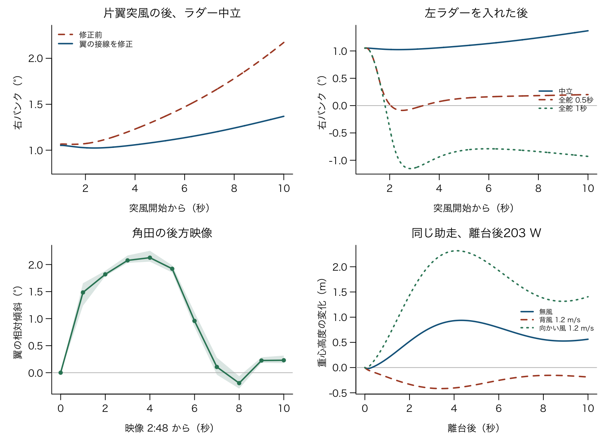

# 聯の背風発進と安定性

現在の助走計算と背風での比較は[聯の助走、桁の曲げと着水](ren-launch-water.md)に掲載した。

## 旧モデルの比較（離台速度8 m/s固定）

ゲームの発進手順で回した。左右の返事の後、「ペラ回します！」から4.1秒間は定位置で300 W、GOから2.5秒間の助走中も300 W。後輪が台端を離れた時点で203 Wに戻し、操舵は中立。ローター回転、クランク位相、脚の余力を離台の前後で引き継ぐ。出力、秒数、後輪位置は再現用の設定である。

| 一様風 | 離台時対気速度 | 2秒後の高度差 | 離台後10秒で最も低い時点 | 10秒後の高度差 |
| --- | ---: | ---: | ---: | ---: |
| 無風 | 8.00 m/s | +0.52 m | −0.02 m（0.10秒） | +0.56 m |
| 背風 1.2 m/s | 6.80 m/s | −0.33 m | −0.42 m（3.45秒） | −0.19 m |
| 向かい風 1.2 m/s | 9.20 m/s | +1.43 m | −0.01 m（0.05秒） | +1.40 m |

高度差は離台時の重心を基準に20 Hzで集計。全条件とも離台時の斜面方向の対地速度は8 m/s。背風で対気速度と動圧が下がり、同じ出力でも揚力と初期の運動が変わる。湖面付近の203 Wには地面効果による余剰出力もある。水平巡航の設計値だけでは発進時の最低高度は決まらない。助走の加速度はプラットフォームの既存モデルで与えており、プロペラ推力とプッシャーの足運びから助走速度を解くところ、非定常失速や主翼の吹き下ろし遅れは今後の改善点である。



## 静安定と動安定

7.20 m/s・203 W・144 rpmのトリムで、湖面の影響を無視できる高さ、無風、舵角固定としてゲーム本体の運動方程式を中心差分で線形化した。静安定は姿勢を乱した瞬間の復元モーメント、動安定はその後の全運動の増減を見ている。

- 縦は、水平速度を保って機首を1°上げると、直後の角加速度が機首下げ方向に約14.48°/s²変化した。ピッチ角速度への減衰微係数は −10.66/s。
- 縦方向の固有値（1/s）は −9.62 ± 4.34i、−0.165 ± 0.675i、−3.35。小さい乱れは減衰する。遅い振動の周期は約9.3秒。
- 横・方向は −27.34、−1.34 ± 0.56i に加え、**+0.0458/s** の緩く増大するモードがある。この成分は約15秒で倍になる。逆ラダーで戻せる傾きが、中立にしておくだけでは残り得る。翼のねじり発散とは独立した剛体のスパイラル不安定である。

縦は前後・上下速度、ピッチ、ピッチ角速度、軸角速度。横は横速度、バンク、ロール・ヨー角速度を状態にした。位置・方位の積分は除外した。尾翼効率、重心と慣性、推力線の仮定に依存する。公表映像で確認できたのは傾斜の**変化**で、実機の安定微係数を同定できる同期舵角・速度・姿勢計測は手元にない。[角田の後方映像との比較](ren-gust-recovery.md)

## 翼のねじりダイバージェンス

聯の三面図から翼弦分布と翼端ねじり下げ2.1°を読み取れる。設計時のねじり角だけでは荷重をかけたときのねじり剛性も、弾性軸の位置も求められない。滑空機モデルには荷重でねじり下がる仮定が入り、聯の通常飛行では曲げたわみを空力へ戻し、ねじり角は設計分布に固定している。現時点ではどちらの実機の発散余裕が小さいかは決められない。[Windnauts資料 pp.20–21](https://www.ifs.tohoku.ac.jp/~Boeing/ppt/20231214/5_Windnauts_2022-23.pdf#page=20)

独立した解析では半翼16.1 mを128区間に分ける。翼根固定・翼端自由で、一様なねじり剛性GJと、空力中心から弾性軸までの腕（後方を正、翼弦比）を仮定した。各区間の微小ねじりで増す揚力とトルクを積分し、翼根から生じるねじりを求め直す。一次ねじりモードの静的な復元剛性がゼロになる動圧を求めた。矩形翼の場合は片持ち梁の解析解と0.01%以内で一致する。局所揚力傾斜は巡航ポーラの有限翼近似、流れは一様、支持線と曲げ・ねじり連成は省略している。[NASAの静的発散試験](https://ntrs.nasa.gov/archive/nasa/casi.ntrs.nasa.gov/20010007233.pdf)

| 仮のGJ（N·m²） | 弾性軸−空力中心（翼弦比） | 計算上の発散速度 | 7.20 m/sでの動圧比 q/qD |
| ---: | ---: | ---: | ---: |
| 1,000 | +0.10 | 6.53 m/s | 1.215 |
| 2,000 | +0.10 | 9.24 m/s | 0.607 |
| 4,000 | +0.10 | 13.07 m/s | 0.304 |
| 2,000 | 0 または負 | 正の臨界値なし | — |

数値は感度を見る仮想例。最初の条件のように設計巡航ですでに発散する仮定は、実機が飛んだ事実と整合しにくい。通常プレイの構造破断・失格には使っていない。実機に寄せるには、既知トルクに対する区間ごとのねじれ角、荷重点を変えて測った弾性軸、翼線・継手の支持条件が必要になる。

[巡航試験ページのねじり発散実験](../cruise.html#torsion)で、剛性・弾性軸・対気速度を動かして同じ境目を確認できる。

### 再計算

```sh
node analysis/ren-stability.js
node analysis/ren-stability.js matrix | Rscript -e 'd<-read.csv(file("stdin")); for(m in split(d,d$mode)) print(eigen(xtabs(value~row+col,m))$values)'
node analysis/ren-divergence.js 2000 0.10 7.2
```
