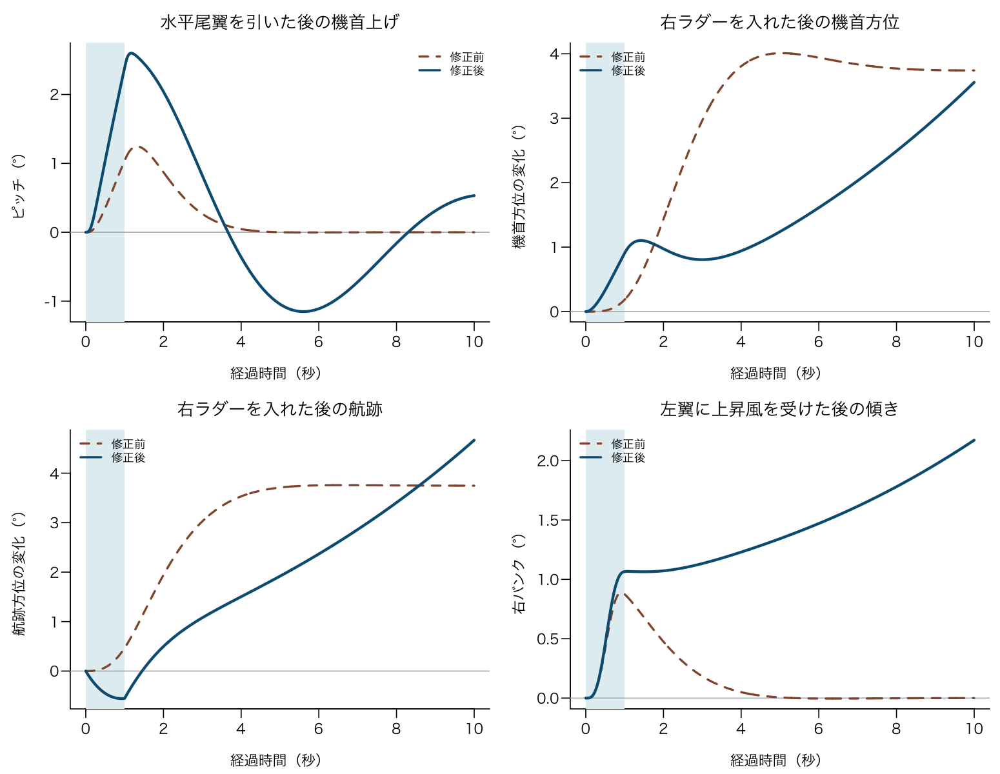

# 聯の尾翼と操舵応答

翼の接線修正後の数値は[片翼突風と逆ラダーの比較](ren-gust-recovery.md)に掲載した。

東北大学 Windnauts の2023年機「聯」で、同じ姿勢・速度・高度・回転数から、修正前（`cdcb279`）と尾翼モデルを比較した。水平尾翼とラダーはいずれも全遊動式で、舵角の上限はそれぞれ ±10°、±12.5°。三面図に記載された面積は 2.01・2.16 m²、翼幅は 3.38・2.90 m、モーメントアームは 5.30・6.10 m。[機体三面図・設計点 pp.20–21](https://www.ifs.tohoku.ac.jp/~Boeing/ppt/20231214/5_Windnauts_2022-23.pdf#page=20)

## 水平飛行と短い操舵

無風、7.20 m/s、水平姿勢、昇降率と角速度ゼロから開始。水面効果が消える極限では、203 W・144 rpmで並進・回転ともに釣り合った。左右翼の代表点が水面から13.12 m（重心高度11.39 m）では水平飛行に必要な出力は新旧とも196.63 W。各機をこの出力と釣り合う142.48 rpmにそろえ、最大舵の25%を1秒間指令して手を離した。

| 1秒間の入力 | 観測量 | 1秒後（旧 → 新） | 2秒後（旧 → 新） |
| --- | --- | ---: | ---: |
| 機首上げ | ピッチ | +1.04° → +2.39° | +0.87° → +2.04° |
| 右ラダー | 機首方位の変化 | 右0.18° → 右0.91° | 右1.43° → 右0.97° |
| 右ラダー | バンク | 右0.88° → 右0.32° | 右1.04° → 右0.48° |
| 右ラダー | 航跡方位の変化 | 右0.47° → 左0.55° | 右1.94° → 右0.50° |

右ラダーが尾部を左に押すと、機首はすぐ右を向く。機体全体は一瞬左に流れ、右に傾いた主翼の揚力で航跡も右に曲がり始める。水平尾翼の引き起こしでは、尾部を押し下げる力がまず働き、機首が上がる。舵を中立に戻した後も姿勢と角速度は連続する。

## 片翼の突風

同じ水平飛行から舵を中立に保ち、最初の1秒だけ、左翼に最大0.50 m/sの上昇風を正弦二乗波形で与えた。

| 突風開始後 | 旧モデルのバンク | 尾翼モデルのバンク |
| --- | ---: | ---: |
| 1秒 | 右0.87° | 右1.07° |
| 2秒 | 右0.48° | 右1.07° |
| 5秒 | 右0.01° | 右1.34° |
| 10秒 | 0.00° | 右2.17° |

右翼の同じ突風では左右が反転し、両翼に一様に与えた対照試験のバンクは0°。旧版では中立入力で水平姿勢に戻る項が働いた。尾翼モデルでは突風後の横滑り、ヨー、左右の揚力差が残り、無修正の10秒間に傾きがさらに増えた。実機のスパイラル安定性を判断するには、横滑り・舵角・ロールの同期記録が必要になる。

## 出力と旋回の10秒比較

重心高度11.39 m、7.20 m/s、144 rpmから出力を切り替えた。水平尾翼は中立、旋回試験は開始と同時に右ラダーを最大まで入れて保持。高度は重心の変位。

| 操舵 | 出力 | 対気速度（m/s）旧 → 新 | 高度変化（m）旧 → 新 |
| --- | ---: | ---: | ---: |
| 中立 | 0 W | 6.673 → 7.189 | −1.357 → −1.884 |
| 中立 | 203 W | 7.216 → 7.201 | +0.040 → +0.055 |
| 中立 | 300 W | 7.453 → 7.208 | +0.621 → +0.869 |
| 右全舵 | 0 W | 6.727 → 8.307 | −1.426 → −3.093 |
| 右全舵 | 203 W | 7.268 → 8.753 | −0.028 → −1.586 |
| 右全舵 | 300 W | 7.505 → 8.970 | +0.552 → −0.996 |

203 Wの右全舵で10秒後のバンクは右11.00°から18.75°、航跡方位の変化は右126.24°から79.29°になった。新モデルでは旋回への入りが遅く、全舵を保持するとバンクが深まり、高度を使って加速する。中立で出力を切った場合も機首が下がり、速度を取り戻しながら沈下する。

## 計算方法と確かさ

- 左右翼と水平・垂直尾翼を各々の位置の風で評価する。各点の速度には機体の並進と剛体回転を含め、舵面の断面に投影した速度と舵角から揚力・誘導抗力を求める。舵面に働く力を重心まわりのモーメントにも変換する。
- ラダーによるヨーが左右翼に前後速度差を生み、横滑りと上反角が左右の迎角差を生む。両方を入れてロールを積分する。水面効果は引き続き左右別々の高さで評価する。
- プロペラが正の推力を出す間は、理想円板の運動量式で軸方向の後流の増速を求める。尾翼のうち円板に重なる翼幅の割合で後流内外の力を合算する。後流の収縮・旋回・偏向と、主翼の吹き下ろしの時間変化は未モデル化。中立時の主翼・推力のピッチモーメントと定常吹き下ろしは巡航トリムにまとめた。
- 尾翼の揚力傾斜には有限翼近似、翼効率に0.8、最大揚力係数に1.1を仮定した。ピッチ慣性は全備質量と推定回転半径1.1 mから、ヨー慣性はロール・ピッチ慣性の和から近似した。舵角・姿勢の実機同期ログによる応答の同定は今後の課題。

現行の値は `node analysis/ren-wing-trials.js` に `trim`、`steering`、`gust`、`steps` のいずれかを渡してCSVで取得できる。計算刻みはゲーム本体と同じ1/120秒。

[片翼突風後のスパイラルと逆ラダー](ren-gust-recovery.md) ／ [背風発進と安定性](ren-stability.md)
