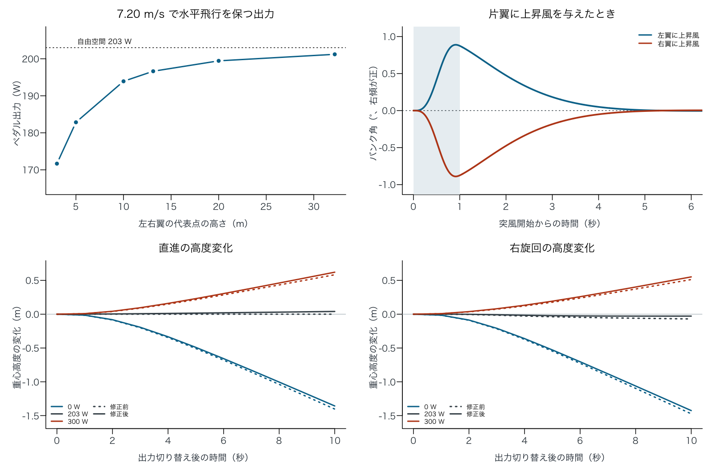

# 聯の左右翼・水面効果・片翼突風の試験

以下はコミット `cdcb279` 時点の試験。現行の操舵で同じ片翼突風を与えた結果は[尾翼の比較試験](ren-tail-response.md)に掲載した。

無風の設計巡航を自由空間の基準とした。チーム資料には7.20 m/s、203 W、144 rpm、22 Nとあるが、この設計点の対水面高度は特定できない。以下は地面効果の高さ依存性と、操舵中に翼ごとに異なる風を受ける場合の計算結果である。[Windnautsの機体諸元 p.21](https://www.ifs.tohoku.ac.jp/~Boeing/ppt/20231214/5_Windnauts_2022-23.pdf#page=21)

## 無風で水平飛行を保つ出力

| 左右翼の荷重代表点の高さ | 抵抗 | ペダル出力 | 自由空間からの減少 |
| ---: | ---: | ---: | ---: |
| 3 m | 18.66 N | 171.7 W | 31.3 W |
| 5 m | 19.85 N | 182.8 W | 20.2 W |
| 10 m | 21.03 N | 193.9 W | 9.1 W |
| 20 m | 21.62 N | 199.4 W | 3.6 W |
| 32.2 m | 21.81 N | 201.2 W | 1.8 W |
| 自由空間の極限 | 22.00 N | 203.0 W | 0 W |

各点とも機速7.20 m/s、水平姿勢、揚力＝重量。左右翼の誘導抗力のみを滑空機と共通の高さ／翼幅の近似式で補正し、胴体等の寄生抗力は重心位置の気流で求めた。必要出力は推力と抵抗が釣り合う回転数を探し、同じプロペラモデルで軸角加速度がゼロになる入力を逆算した。有限高度の各解を10秒積分すると高度変化はいずれも0.000001 m未満。これは連続入力の計算上の出力で、ゲームのペダル操作は0・203・300 Wの3段階。

## 上昇風の向きとロール応答

左右それぞれ半翼の楕円荷重の中心（機体中心から約6.83 m）に代表点を置いた。左右の世界座標に機首方位、ピッチ、バンク、主翼の取り付け高さと上反を反映。水平姿勢では代表点は重心の約1.73 m上。風による荷重差をロールモーメントに変換し、上昇する側の翼では上下方向の相対風によって追加荷重が低下する。無風時の操舵応答に既に含まれる減衰との重複を避けるため、この相対速度は元の操舵応答からの増分で計算する。

翼の代表点高度13.12 m、無風での水平飛行（196.63 W）から開始し、舵を中立に保った。片側に1秒間、最大0.5 m/sの上昇風を正弦二乗の単発パルスで与えた。反対側と機体中心には上昇風を与えていない。左翼が受けると左翼が持ち上がり、最大右0.89°（0.92秒）。右翼では同時刻に左0.89°。2秒時点は左右とも絶対値0.48°、5秒時点は0.01°未満。両翼一様の対照試験のバンクは0°。旧モデルは機体中心のみの風を用いるため、この片翼パルスに対するロールは0°。

代表点で剛体翼の荷重を近似し、実効ロール慣性は空虚重量の45%が翼幅方向に一様に分布すると仮定した。揚力増加・ピッチ変化を伴う詳細な地面効果、翼端だけに当たる狭い突風、翼の動的な曲げ・ねじりは含まない。減衰・慣性・地面効果係数を聯の実測から同定した結果ではない。

## 旧版と同じ状態からの10秒比較

旧版の無風飛行90秒時点を基準に、重心高度11.3869 m、対気速度7.20 m/s、昇降率・姿勢角・各角速度ゼロ、144 rpmで両モデルを開始した。新モデルにとっては同じ高度で203 Wを入れると約6.4 Wの余裕がある。右旋回は出力変更と同時に右ラダーをいっぱいに入れて保持し、水平尾翼は中立とした。

| 飛び方 | 出力 | 対気速度・旧 → 新（m/s） | 重心高度変化・旧 → 新（m） |
| --- | ---: | ---: | ---: |
| 直進 | 0 W | 6.656 → 6.673 | −1.403 → −1.357 |
| 直進 | 203 W | 7.200 → 7.216 | 0.000 → ＋0.040 |
| 直進 | 300 W | 7.439 → 7.453 | ＋0.583 → ＋0.621 |
| 右旋回 | 0 W | 6.708 → 6.727 | −1.474 → −1.426 |
| 右旋回 | 203 W | 7.252 → 7.268 | −0.070 → −0.028 |
| 右旋回 | 300 W | 7.490 → 7.505 | ＋0.512 → ＋0.552 |

再計算には `node analysis/ren-wing-trials.js trim`（出力と水平維持の確認）、`gust`（左右・一様のロールを毎秒120点）、`steps`（旧版と同じ初期状態から各条件を毎秒出力）を使用する。旧版はコミット `40d8410` の `node analysis/ren-power-step.js` で再現できる。ゲーム画面からの通常の離台は、離台直後から新モデルの水面効果を受ける。
