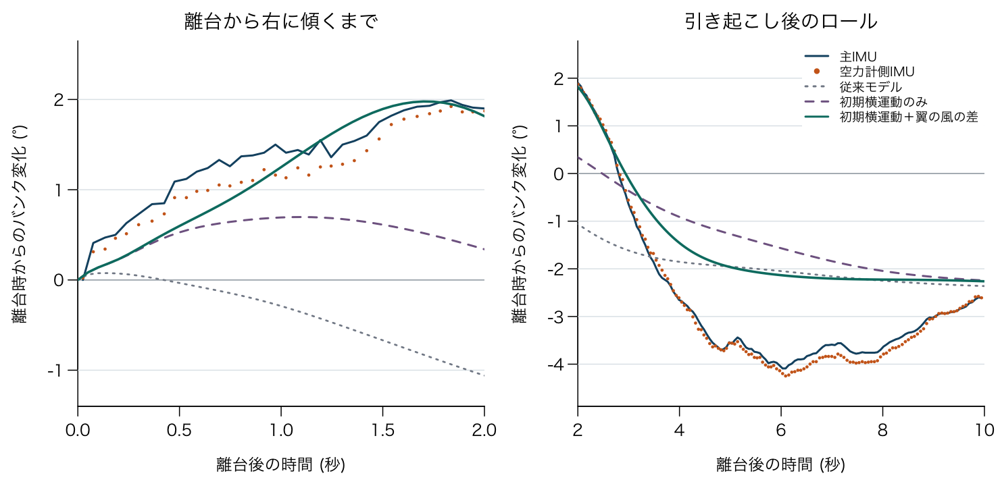

# 竜海は離台から2秒でなぜ右に傾いたか

離台を機上3.90秒に固定した。2秒後の傾きの変化は、主IMUで右1.90°、空力計側で右1.87°。前回の計算は左1.06°だった。離台前の風見とIMUから推定した横運動を与えると右0.34°になり、左右の翼に当たる鉛直風に差を仮定すると右1.82°になった。初期状態をゼロと置いた影響はログで検証できる一方、当時の翼ごとの風は測定されていない。[機上生ログ](https://github.com/torica-org/25th_Analysis/blob/115723c24ce9e64c07c79215770acc7559518d42/getWindVector/src/2025FlightLog.csv)・[前回の手放し試験](tatsumi-wing-handoff-roll.md)



## ログから決められる初期状態

鳥科の解析では横滑り角（AoS）が正のとき、機体の右翼方向に対気速度成分がある。生の風見角から312.36°を引くと集計済みのAoSになる。方位は時計回りを正として 325° − 主IMUのYaw。離台**前**0.25秒の4行から、AoSの中央値−3.865°と方位の回帰勾配+0.80°/sを得た。離台後のAoSやYawは入力に使っていない。[チームの風見角の処理](https://github.com/torica-org/25th_Analysis/blob/115723c24ce9e64c07c79215770acc7559518d42/getWindVector/analysisMain.m)・[座標系と風の変換式](https://github.com/torica-org/25th_Analysis/blob/115723c24ce9e64c07c79215770acc7559518d42/getWindVector/getWindFromFlightData.m)

- 風見の角度は機体軸の右向き・前向き対気速度の比で扱った。既存の8 m/s、経路角−7°、離台ピッチ0°、右バンク2.50°に合わせて水平横速度に直すと−0.580 m/s。台端の環境横風をゼロと仮定した等価な初期値で、横方向の対地速度の独立した測定ではない。風見の取り付け位置での回転速度・局所流の補正は含まない。
- 方位変化率にはピッチ回転も混ざる。モデルの機首下げ角速度−14°/sと離台バンクで機体軸に戻すと、ヨー角速度は+1.41°/sになる。推定窓を離台前0.20〜0.40秒に変えると方位変化率は−0.09〜+1.12°/s、初期横運動のみの2秒後は右0.04〜0.51°。4点からの推定なので、ヨー単独の寄与にはこの幅がある。
- 前回との比較のため、初期バンクとロール角速度には同じ+2.50°と+2.09°/sを用いた。後者には離台前後0.20秒の主IMUを使っている。左右同時の手放し、ラダー中立、体重移動の制御則、推定向かい風、翼剛性・空力係数は全条件で共通とした。

## 同じ飛行で要因を一つずつ変えた結果

符号は右バンクを正とし、2秒後は離台時からの角度変化。RMSEは離台後0〜2秒の35収録時刻で求めた。各IMUから自身の離台時の補間角を引き、同じ時刻のモデルと照合した。片翼の風は離台後2.5秒間、半翼の揚力中心で滑らかに強まり弱まる鉛直風を与えた。ピークは1.25秒、左は上向き+0.25 m/s、右は下向き−0.25 m/s。それぞれ単独で試したうえで重ねた。[加工済みログ](https://github.com/torica-org/25th_Analysis/blob/115723c24ce9e64c07c79215770acc7559518d42/flightDataPlot/src/2025_Tatsumi.csv)・[比較コード](../analysis/opening-lateral.js)

| 条件 | 2秒後 | 主IMU RMSE | 空力計側 RMSE |
|---|---:|---:|---:|
| 従来の自由飛行 | −1.06° | 1.86° | 1.72° |
| 初期横滑りのみ | −0.06° | 1.15° | 1.02° |
| 初期ヨー回転のみ | −0.66° | 1.60° | 1.46° |
| 初期横滑り＋ヨー回転 | +0.34° | 0.90° | 0.77° |
| 左翼の上昇流のみ | −0.33° | 1.46° | 1.31° |
| 右翼の下降流のみ | −0.30° | 1.45° | 1.30° |
| 左右の風の差のみ | +0.42° | 1.08° | 0.91° |
| 初期横運動＋左翼の上昇流 | +1.05° | 0.52° | 0.38° |
| 初期横運動＋右翼の下降流 | +1.11° | 0.50° | 0.35° |
| **初期横運動＋左右の風の差** | **+1.82°** | **0.29°** | **0.23°** |

右に傾いた状態から横速度・ヨー回転をゼロで始めると、初期の右向きロール角速度は空力減衰で落ち、機体は左へ戻る。実測の負の横滑りを与えると、竜海用訓練モデルの負のロール微係数から右向きのモーメントが生じる。最初の2秒では横滑りの初期化が約+1.00°、ヨー回転の初期化が約+0.40°ぶん従来値を右へ動かした。翼ごとの風は各翼の迎角・動圧・弾性応答を通じて揚力に作用する。初期横運動を共通にして上下の風向を入れ替えると、2秒後は左1.14°になった。[鳥科の訓練モデルと横運動の係数](steering-validation.md)

## 2〜10秒のピッチ・高度と残差

各欄は **2〜5秒／5〜10秒** のRMSE。ピッチ・計器高度・ピトー速度は、0.25秒刻みで前後0.25秒の実測中央値と比較した。ロールは各IMUの元の収録時刻（55点／84点）で比較した。

| 指標 | 従来の自由飛行 | 初期横運動＋左右の風の差 |
|---|---:|---:|
| 主IMUロール (°) | 1.582／1.408 | 1.029／1.385 |
| 空力計側ロール (°) | 1.615／1.547 | 1.032／1.524 |
| ピッチ (°) | 1.519／0.517 | 1.529／0.503 |
| 計器高度 (m) | 0.518／1.107 | 0.514／1.142 |
| ピトー速度 (m/s) | 0.183／0.116 | 0.143／0.116 |

片翼だけに風を与えると揚力の総量も変わる。例えば初期横運動＋左翼の上昇流では2〜5秒のピッチRMSEが2.156°まで広がる。左右逆向きの風を組み合わせると、揚力の差で機体を傾けながら、揚力の合計の変化を抑えられた。従来の自由飛行に対するピッチRMSEの悪化は前半0.010°、高度RMSEの悪化は後半0.035 m。GPS航跡を規定した従来の縦運動専用基準に比べると、ピッチ1.520°／0.508°、高度0.504 m／1.095 mが比較元になる。

**翼の風は、この大会飛行に合わせた仮説である。** 風のピークを各0.20〜0.30 m/s、持続を2〜3秒とした候補から、最初の2秒で両IMUに近く、後続区間のピッチ・高度も保つ条件を選んだ。両IMUは同じ飛行のセンサーで、別飛行での検証はしていない。実機の機上5.902秒（離台後2.002秒）ではAoSは+10.46°。再現試算の2秒後の横滑り角は+4.35°で、機体中央の気流にはまだ大きな残差がある（風見角と訓練モデルの横滑り角には定義の差もある）。翼に実際にこの風が吹いたとは特定できない。今回の設定は公開版の大会再現比較で選べる。

### 再計算

```sh
node analysis/opening-lateral.js path/to/2025FlightLog.csv path/to/2025_Tatsumi.csv
node analysis/opening-lateral.js path/to/2025FlightLog.csv path/to/2025_Tatsumi.csv --csv | Rscript analysis/plot-opening-lateral.R
node analysis/export-opening-comparison.js path/to/2025_Tatsumi.csv
```
