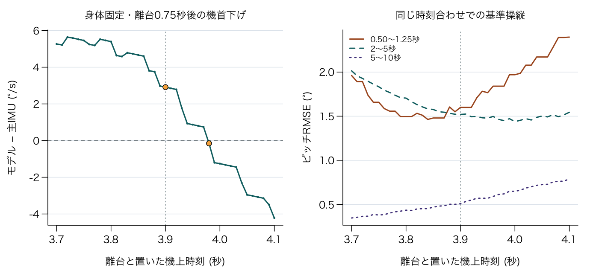

# 竜海の離台0.75秒後に残る機首下げの差

身体を離台位置に固定したモデルでは、離台を機上時刻3.90秒に置くと、実機より機首下げが2.91°/s緩い。離台の候補を0.08秒遅らせると差は−0.15°/sになる。0.75秒の一点なら、時計の合わせ方だけでほぼ全量を説明できる。同じずらし方では基準操縦の0.50〜1.25秒と5〜10秒のピッチ誤差が広がった。ゲームと映像比較には従来の離台時刻・飛行条件を採用した。[離台後3秒の映像・IMU・モデル](https://97kuek.github.io/birdman-contest-simulator/opening.html)・[前回の体重移動の切り分け](tatsumi-opening-window.md)



## 機上ログの原点を動かす

機上時刻3.70〜4.10秒を0.01秒刻みで調べた。機体・風・操作を固定して実測の時刻だけを動かす。各候補の離台0.75秒後を中心に、前後0.20秒に実際に収録された主IMUのピッチに直線を当てた。モデルも同じ標本時刻まで補間し、同じ方法で変化率を求めた。下表の残差は「モデル − 主IMU」で、正ならモデルの機首下げが緩い。身体固定は原因を切り分ける短時間の試算で、2〜10秒には通常の基準操縦を使う。[チームの処理済みCSV](https://github.com/torica-org/25th_Analysis/blob/115723c24ce9e64c07c79215770acc7559518d42/flightDataPlot/src/2025_Tatsumi.csv)

| 離台と置く機上時刻 (s) | 主IMU (°/s) | 身体固定 (°/s) | 残差 (°/s) | 初期ピッチ・角速度も同じ原点のIMUから与えた残差 (°/s) |
|---:|---:|---:|---:|---:|
| 3.70 | −13.91 | −8.64 | +5.27 | +5.11 |
| 3.90 | −11.56 | −8.65 | +2.91 | +2.92 |
| 3.95 | −9.48 | −8.61 | +0.87 | +0.90 |
| 3.97 | −9.48 | −8.74 | +0.74 | +0.78 |
| 3.98 | −8.52 | −8.67 | −0.15 | −0.09 |
| 4.00 | −7.33 | −8.59 | −1.26 | −1.20 |
| 4.10 | −4.31 | −8.53 | −4.22 | −4.09 |

3.97秒と3.98秒の間で評価窓に入る収録点が変わる。窓の半幅を0.15／0.20／0.25秒とすると、3.98秒での残差は−0.39／−0.15／+0.61°/sとなる。別系統の空力計側IMUでも、3.90秒原点で−11.73°/s、3.98秒原点で−8.18°/sと同じ向きに動いた。収録周期は約0.056秒。0.01秒刻みの探索は真の離台時刻をその精度で決めるものではない。[機上生ログと両IMUの検証](release-imu.md)

超音波計が示す台端通過、翼持ちの最後の接触、機体が画面上で台から離れて見える瞬間にはずれがある。映像とログの対応幅約±0.60秒には映像側の判読幅も入っている。今回、ログの原点を動かす幅には超音波計とIMUから得た±0.20秒を使った。[機上時刻の根拠](release-imu.md)・[大会映像の時刻合わせ](tatsumi-video-timing.md)

## 翼持ちの手放しと尾翼の風を別々に加える

以下は力と風速を仮定して応答を見る感度試験。主翼と尾翼を流れる基準風、離台速度、ピッチ・角速度、身体位置は全ケースで共通とした。

- **翼持ち**は左右同時に、機体中心から3.12 mの位置で各翼に上向き25 Nを加える。作用位置はゲームの正面発進時の翼持ちの配置を使った。助走中から一点荷重を曲げモードと翼根モーメントに加え、最後の0.15秒で滑らかにゼロへ戻した。台端で手放す場合、飛行に引き継ぐのはたわみとその速度。0.15秒遅く手放す場合だけ、台端通過後に残る力を鉛直加速度とピッチモーメントにも加えた。前後の作用位置は基準重心の後方0.25 mを仮定した。逆向きの荷重、50 N、早い手放し、重心前方での遅い手放しも比較した。[翼持ちの位置](../src/rendering/crew.js)・[翼の構造式](../src/domain/wing-structure.js)
- **尾翼の風**は台端を中心に、水平尾翼でだけ主翼と異なる上向き・下向きの流れが生じる場合を試した。標準の風域は前後各2.9 m、鉛直風速は台端で最大±0.25 m/s、両端で滑らかにゼロ。尾翼の位置、機体の姿勢とピッチ回転から局所流速・迎角・動圧を求め、尾翼に生じた力を機体の並進と回転の両方に反映する。既存の主翼の吹き下ろし計算も働く。この試算に風域の幅や風速の実測値はない。鳥科が公開したピトー管と風向センサーの位置は機体上部で、尾翼位置の風速や翼持ちの荷重のログは公開データに見当たらない。[鳥科の実機説明・三面図](https://torica-tus.com/2025/11/14/2025/)・[計算条件](../analysis/release-loads.js)

| 実験条件 | 身体固定時の0.75秒残差 (°/s)、原点3.90秒 | 同、原点3.98秒 | 通常操縦のピッチRMSE 0.50〜1.25秒／2〜5秒／5〜10秒 (°)、原点3.90秒 |
|---|---:|---:|---:|
| 現行 | +2.91 | −0.15 | 1.600／1.520／0.508 |
| 翼持ち各+25 N、台端で手放し | +2.89 | −0.18 | 1.619／1.511／0.503 |
| 同じ荷重、台端の0.15秒後に手放し | +2.82 | −0.24 | 1.566／1.507／0.518 |
| 尾翼だけ上向き0.25 m/s | +2.67 | −0.44 | 0.772／1.746／0.776 |
| 尾翼だけ下向き0.25 m/s | +3.18 | +0.16 | 2.599／1.445／0.275 |
| 上向き風域を前後各4.35 mに拡張 | +2.02 | −1.06 | 0.604／1.880／0.904 |
| 翼持ち各+25 N（台端まで）と標準幅の上向き風 | +2.64 | −0.47 | 0.779／1.736／0.771 |

各25 Nの手放しで離台時の翼端たわみは0.564 mから0.575 mまで増えたが、0.75秒の変化率への影響は0.03°/sだった。早く手放すと約0.01°/s、各50 Nでも約0.06°/s。これは左右対称の鉛直荷重についての結果で、実機での手の力への上限ではない。離台前に胴体へ蓄積した角運動量は初期角速度に含まれる。ここに離台前の力積をもう一度加える調整はしていない。片側だけの手放し、翼持ちの押す方向、翼の局所ねじりは未同定である。

尾翼の上向き風は初期の機首下げを深くしたが、2〜5秒の高度／対気速度RMSEは0.504 m／0.182 m/sから0.785 m／0.403 m/sへ増えた。風域を半分にした場合には0.75秒残差が逆に+2.96°/sになる。風を通過した後の姿勢の戻り方も評価点に現れるため、単一の風速をこの点に合わせても当日の尾翼流は決められない。

## 公開版で採用した条件

基準は機上時刻3.90秒、離台姿勢0°、角速度−14°/s、追加の翼持ち荷重・尾翼局所風はゼロ。通常操縦でのピッチ／計器高度／ピトー速度のRMSEは、2〜5秒で **1.520°／0.504 m／0.182 m/s**、5〜10秒で **0.508°／1.095 m／0.115 m/s**。原点だけを3.98秒に替えると、初期ピッチRMSEは1.600°から1.840°、5〜10秒は0.508°から0.620°になる。さらに初期姿勢・角速度を同じ原点で取り直すと2〜5秒と5〜10秒は1.811°、0.841°だった。

原因をさらに絞るには、まずIMUと同じ時計で左右の最終接触を記録する。次に手放し前後の翼端変位か支持荷重と、尾翼位置の局所流向のいずれかを独立に測れば、一つのピッチ履歴で両方を推定する必要がなくなる。

## 再計算

チームの固定版CSVを使う。解析時にファイルのGit blobを照合する。[処理済みCSV](https://github.com/torica-org/25th_Analysis/blob/115723c24ce9e64c07c79215770acc7559518d42/flightDataPlot/src/2025_Tatsumi.csv)・[生CSV](https://github.com/torica-org/25th_Analysis/blob/115723c24ce9e64c07c79215770acc7559518d42/getWindVector/src/2025FlightLog.csv)

```sh
node analysis/release-loads.js path/to/2025_Tatsumi.csv
node analysis/release-loads.js path/to/2025_Tatsumi.csv --offsets-csv | Rscript analysis/plot-release-offset.R
python3 analysis/release-imu.py path/to/2025FlightLog.csv path/to/2025_Tatsumi.csv
```
