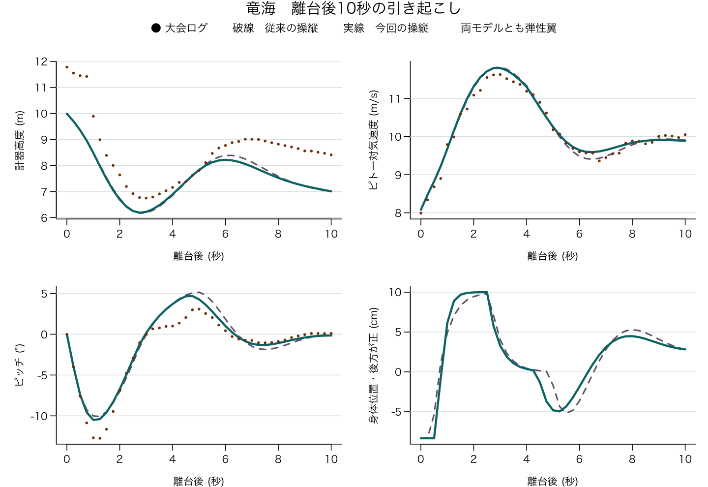

# 竜海の離台姿勢と引き起こし後の中立復帰

2025年の主IMUで、機首下げの速さは離台時点では従来のモデルとほぼ一致した。差が大きくなるのは離台0.5〜0.75秒後で、モデルの機首下げが先に緩む。一方、5秒以降のピッチ誤差には、モデルのパイロットが中立を保つ時間が効いた。[2系統のIMUの生値・時刻・窓幅の確認](release-imu.md)

## 大会ログと公開版の比較

離台を機上時刻3.90秒に置いた。高度は模擬計器とチーム補正気圧高度、速度は模擬ピトーと処理済み対気速度、ピッチは機首上げを正として主IMUと比較した。従来と同じ0.25秒間隔の41時点で、実測には前後0.25秒の中央値を使った。以下は旧公開版 `dd499b8` → 今回の二乗平均平方根誤差（RMSE）。区間の両端を含み、高度の起点や時間を合わせ直す補正は加えていない。[前版の検証](elastic-pullup.md)・[チームの処理済みログ](https://github.com/torica-org/25th_Analysis/blob/115723c24ce9e64c07c79215770acc7559518d42/flightDataPlot/src/2025_Tatsumi.csv)

| 離台後 | 計器高度 (m) | ピトー対気速度 (m/s) | ピッチ (°) |
|---|---:|---:|---:|
| 0〜2秒 | 1.576 → 1.588 | 0.170 → 0.189 | 1.581 → 1.402 |
| 2〜5秒 | 0.510 → 0.497 | 0.182 → 0.178 | 1.756 → 1.613 |
| 5〜10秒 | 1.042 → 1.090 | 0.090 → 0.109 | 1.085 → 0.512 |
| 0〜10秒 | 1.079 → 1.104 | 0.141 → 0.150 | 1.423 → 1.164 |



図の破線と実線はどちらも今回の尾翼計算を使い、同じ弾性翼、基準風、機体、発進条件で操縦だけを変えた。右下の身体位置は計算値。実機には対応する変位ログがない。[条件別の再計算コード](../analysis/tatsumi-release.js)

## 要因を一つずつ替えた結果

従来の基準操縦は、離台0.4秒後に後方入力、2.6秒後に中立、4.9秒後に速度・昇降率・角速度に応じた調整を再開する。下表は同じ新しい尾翼計算を使い、記載の条件だけを変更した。

| 変更 | 最低ピッチ (°) | 2〜5秒のピッチRMSE (°) | 5〜10秒のピッチRMSE (°) |
|---|---:|---:|---:|
| 従来の姿勢・操縦 | −10.09 | 1.76 | 1.08 |
| 離台姿勢のみ 0 → −0.19° | −10.18 | 1.80 | 1.11 |
| 初期角速度のみ −14 → −14.41°/s | −10.13 | 1.78 | 1.09 |
| 初期角速度のみ −18.06°/s（離台直後の片側窓） | −10.49 | 1.91 | 1.21 |
| 後方入力を0.5秒から、入力中の時定数を0.45 → 0.20秒 | −10.51 | 2.01 | 1.10 |
| 中立に戻し始める時刻のみ 2.6 → 2.5秒 | −10.09 | 1.46 | 1.02 |
| 中立保持を終え、姿勢調整に戻る時刻のみ 4.9 → 4.4秒 | −10.09 | 1.68 | 0.56 |
| 今回採用した操縦（後方入力・中立・姿勢調整を合わせて変更） | −10.51 | 1.61 | 0.51 |

初期姿勢と角速度は、主IMUの対称窓で得た値と整合する0°・−14°/sを採用した。身体は後方への移動を少し遅く始め、その後は指令位置に速く近づく。移動上限は前後各10 cm、速度上限は0.30 m/sで共通。入力を離した後は0.45秒の時定数で中立へ近づく。手動飛行では開始・解除の時刻をプレイヤーが決める。上表の時刻はこの試技に合わせた推定である。[体重移動の計算](../src/domain/pilot-shift.js)

最低ピッチは実機−12.75°に対して旧版−10.09°、今回−10.51°。水平を通過する時刻は実機3.01秒、旧版3.01秒、今回2.97秒だった。高度の回復量は実機2.26 m、旧版2.22 m、今回2.03 mで、最初の山も実機6.75秒に対して旧版6.25秒、今回6.00秒と早まった。全飛行は53.64秒・421.54 mで、実際の大会記録433.02 mを11.48 m下回る。調整に飛距離は使っていない。[鳥科の機体諸元・大会記録](https://torica-tus.com/2025/11/14/2025/)

同期への依存も調べた。試算は固定し、処理済みCSV各行の実時刻で姿勢を補間して、中央値処理前のピッチを比較した。離台同期を3.70／3.90／4.10秒としたとき、各174標本の10秒RMSEは旧操縦1.76／1.48／1.78°、今回1.65／1.21／1.47°。同じ試技の測定時刻を動かした感度試験であり、別試技での予測精度は未検証である。

## 計算と3D形状の修正

水平尾翼には、重心位置の対気速度に機体回転による尾翼位置の速度を加える。機首上げ角速度を q、尾翼腕を l とすると、尾翼は重心に対して下向きに ql の速度を持つ。翼断面内の前後・上下速度から局所迎角と動圧を求め、その局所流に垂直な揚力を重心での並進力とピッチモーメントに変換した。竜海とQX-25で同じ計算を使う。揚力が尾翼の局所流に対して仕事をしないことを、正負の角速度と迎角の組み合わせで検証した。尾翼計算だけを新しくすると、今回の試技で最低ピッチが変わる量は0.01°未満だった。[尾翼の計算](../src/domain/aerodynamic-lift.js)・[物理量の回帰テスト](../tests/physics-audit.test.js)

翼の3D表示では、助走中の計算済み変位が毎フレーム消える不具合を修正した。正面・向かい風で竜海の主桁翼端は、助走時間の半分で約0.22 m、台端直前で約0.71 m持ち上がる。両機・左右の主桁について、変形後の3D頂点とソルバーのたわみが一致し、離台前後で高さが連続することを確認した。翼持ちの局所荷重と手を離す時刻は推定に残る。[翼端の検証](../tests/ramp-wing-rendering.test.js)

## 次に精度を上げるための実測

離台前後を横から固定撮影し、台端・胴体の基準点・パイロットの肩と腰を同じフレームで追えば、離台時刻と身体の移動を別々に拘束できる。正面映像では翼根を基準に左右翼端の相対高さを追い、翼持ちの手放し時刻を記録する。これらを共通の合図でIMU・ピトー・気圧計と同期し、独立した試技の風と計器ログを使って、係数を固定したまま残差を確認する。現状で実測との比較ができる量と、仮定に依存する他機・強風・破断域を区別して扱う。[構造モデルの出典と限界](wing-structure.md)・[計算刻み・言語・描画の評価](technology.md)

`node analysis/tatsumi-release.js` で全条件の表を再計算できる。チームの固定版 `2025_Tatsumi.csv` を引数に渡すと同期感度も出る。図の再生成は次のコマンドで行う。

```sh
node analysis/tatsumi-release.js --csv | Rscript analysis/plot-elastic-pullup.R former-input adopted docs/tatsumi-release.png
```
