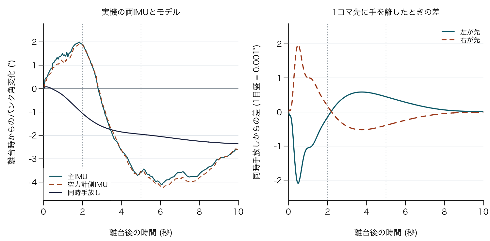

# 竜海の翼持ちが1コマずれて手を離した場合

離台を機上 **3.90秒** に固定すると、片翼25 Nの支持力を最後の0.15秒で抜くモデルでは、左右どちらが先かを入れ替えたときのバンク角の差は最大 **0.0041°**（離台後0.49秒）だった。2秒後には、主IMUも空力計側IMUも離台時より約1.9°右に傾いている。3通りの計算はいずれも約1.1°左への変化を示し、1コマの手放し差でこの食い違いを説明することはできなかった。



## 3通りで変えた条件

映像の1コマは1001/30000秒（約33.37 ms）。左・右は操縦席から見た向きで、右の翼が下がるバンクを正とした。荷重がゼロになる時刻を次のように置いた。3通りとも離台時刻と両翼の平均手放し時刻は共通。映像で手元と翼の隙間を初めて確認できたコマからは、支持力が実際にゼロになった時刻や手放し順は決められない。[手元をコマ送りした結果](tatsumi-wing-handoff.md)・[チームの大会映像](https://www.youtube.com/watch?v=brdhsnknoKs&t=122s)

| 条件 | 左翼の荷重終了（離台後） | 右翼の荷重終了（離台後） |
|---|---:|---:|
| 同時 | 16.68 ms | 16.68 ms |
| 左が先 | 0 ms | 33.37 ms |
| 右が先 | 33.37 ms | 0 ms |

左右それぞれに上向き25 N、作用位置は中心から横3.12 m、基準重心から後ろ0.25 mを仮定。助走中から翼ごとにたわみとたわみ速度を積分し、その状態を離台後へ引き継いだ。助走中の胴体は台に拘束される。離台後は両手の残りの力を鉛直加速度に、作用位置と力から求めたモーメントを機体の回転に加えた。荷重は終了前0.15秒で半コサイン状に減るため、遅い側に離台時点で残っている力は約2.9 N。手で支えた力や作用位置を直接測ったデータはなく、この設定は以前の荷重試験と共通の仮定である。[荷重設定の根拠](tatsumi-release-loads.md)

竜海の基準操縦、前後の体重移動の制御則、離台速度、ピッチ、推定向かい風をそろえた。3通りともラダーは中立、横風・片翼への突風はゼロ。機首方位・バンク・横移動は自由に積分した。初期バンクは主IMUの離台時補間値+2.50°、初期ロール角速度は前後0.20秒の主IMU角度に当てた直線の傾き+2.09°/s。離台ピッチ0°ではこの角度変化率とモデルの機体軸ロール角速度は一致する。初期値の推定には離台直後の観測も含まれるため、この比較から離台の瞬間の角速度を独立に検証することはできない。

## 実機の両IMUとの比較

主IMUの生ログのロールは、鳥科の加工済みログの Roll と全行一致する。空力計側は主IMUと同方向に変化し、離台時補間値が+3.63°だった。取り付け差などの定数分を手放し効果に混ぜないよう、両センサーとモデルでそれぞれ離台時の角度を引いた。次の表は収録時刻にモデルを線形補間し、各IMUに対する角度変化のRMSEを求めたもの。各欄は主IMU／空力計側IMUの順で、単位は度。[機上生ログ](https://github.com/torica-org/25th_Analysis/blob/115723c24ce9e64c07c79215770acc7559518d42/getWindVector/src/2025FlightLog.csv)・[鳥科のロール符号の定義](https://github.com/torica-org/25th_Analysis/blob/115723c24ce9e64c07c79215770acc7559518d42/getWindVector/getWindFromFlightData.m)

| 条件 | 0〜2秒（35点） | 2〜5秒（55点） | 5〜10秒（84点） |
|---|---:|---:|---:|
| 同時 | 1.862／1.718 | 1.582／1.615 | 1.408／1.547 |
| 左が先 | 1.863／1.718 | 1.582／1.615 | 1.408／1.547 |
| 右が先 | 1.861／1.717 | 1.582／1.615 | 1.408／1.547 |
| 両IMUどうしのRMS差 | 0.186 | 0.088 | 0.152 |

最初の10秒のログ行間隔の中央値は0.058秒。最初の2秒の角度変化は実測で主IMUが最大+1.99°、空力計側が最大+1.92°だった。右先で誤差はわずかに小さくなるが、角度履歴には手放し順の違いよりはるかに大きな残差がある。両IMU間のRMS差には動的な測定差も含まれ、センサーの仕様上の精度や統計的な検出限界を表す値ではない。

## 2〜10秒に残る影響

| 同時条件に対するバンク角の最大差（符号付き） | 左が先 | 右が先 |
|---|---:|---:|
| 0〜2秒 | −0.00209° | +0.00197° |
| 2〜5秒 | +0.00059° | −0.00052° |
| 5〜10秒 | +0.00045° | −0.00039° |

ピッチ・高度・対気速度は従来と同じ0.25秒刻みで、前後0.25秒に取れた実測の中央値に対するRMSEを計算した。2〜5秒／5〜10秒の順に、同時条件のピッチは1.519°／0.517°、計器高度は0.518 m／1.107 m、ピトー速度は0.183 m/s／0.116 m/s。左先または右先に変えたとき、各区間のRMSEの変化はそれぞれ0.0003°、0.0003 m、0.0002 m/s未満だった。横運動を自由にしたことや初期バンクを与えたことも含めると、従来の基準飛行とは小さな差がある。従来条件のピッチRMSEは今回の再計算でも1.520°／0.508°だった。[加工済み機上ログ](https://github.com/torica-org/25th_Analysis/blob/115723c24ce9e64c07c79215770acc7559518d42/flightDataPlot/src/2025_Tatsumi.csv)

荷重の仮定を変え、直前まで各25 Nを保って瞬時に手を離す条件でも同じ3通りを試した。この場合の同時条件からの最大差は左先−0.0051°、右先+0.0056°。2〜10秒では最大0.0023°未満だった。積分を120 Hzから480 Hzに細かくすると、最初の2秒のピーク差の変化は、滑らかな手放しで0.00002°未満、瞬時の手放しで0.00007°未満。この感度試験の数値を、実機に生じ得る傾きの上限には使えない。実機の度単位の残差を調べるには、離台前からの横運動、横風、左右の実荷重を独立に拘束できる観測が必要になる。

### 再計算

リポジトリのルートで次を実行する。CSVは上記の固定版を使い、読み込み時にGit blobを照合する。

```sh
node analysis/wing-handoff-roll.js path/to/2025FlightLog.csv path/to/2025_Tatsumi.csv
node analysis/wing-handoff-roll.js path/to/2025FlightLog.csv path/to/2025_Tatsumi.csv --csv | Rscript analysis/plot-wing-handoff-roll.R
```
