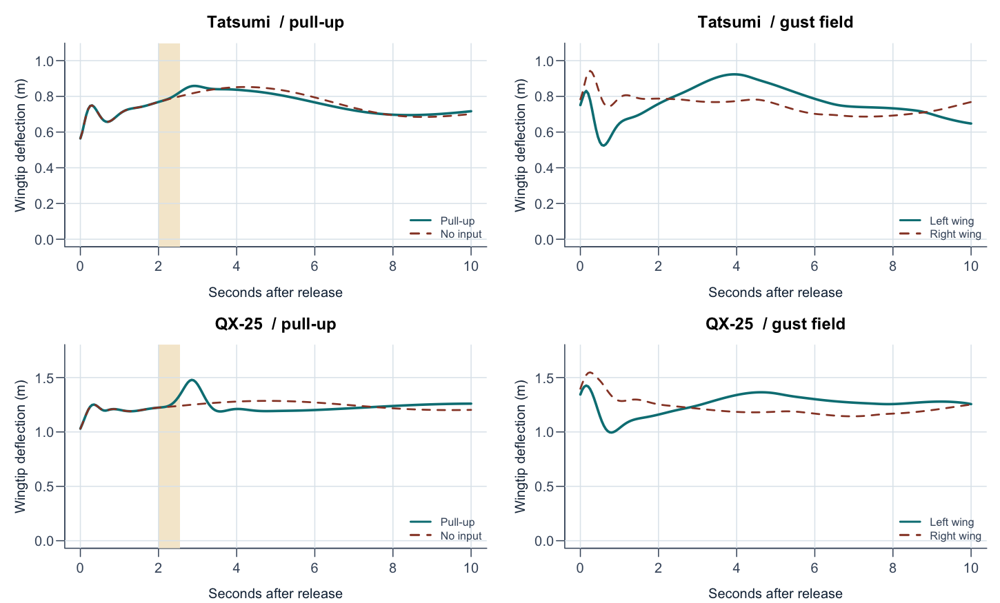

# 竜海・QX-25の主翼のたわみと荷重試験

2026年11月の操縦モデル更新後の比較は[竜海の弾性翼と引き起こし](elastic-pullup.md)にまとめた。

2025年の公式三面図から読み取れる、定常滑空に伴う翼端の上向き変位は **竜海が0.753 m、QX-25が1.234 m**。いずれも図面上の値で、大会中の翼端を計測した値ではない。翼端は翼の上反角によっても上がるため、モデルには上反のついた外形にこの変位を加える。[竜海の三面図](https://torica-tus.com/wp-content/uploads/2025/11/03-【東京理科大学鳥人間サークル鳥科】-47-2025_鳥人間コンテスト三面図-1-レイアウト1.pdf)・[QX-25の三面図](https://www.q-birdman.jp/history/images/qx-25.pdf)

| 三面図の読み方 | 竜海（東京理科大学 鳥科） | QX-25（九州大学） |
|---|---|---|
| 正面図のどこを見るか | 図の右端。翼根の水平基準線から元の翼端までが1,120 mm、定常滑空時の弾性曲線までが1,873 mm。差は753 mm | 図の左端。「定常飛行時のたわみ」の曲線と元の翼端の間を直接1,234 mmと寸法記入 |
| 上反の表記 | 4°と8°の二段。鳥科は上反角部の製作法をこの機体で変更 | 7°の上反部。接合部とは別に位置を記入 |
| 主翼桁 | CFRP製。0番から6番の径は120、110、100、85、70、55、43 mm | CFRPパイプ。胴体側に径113 mm、外翼側のテーパー部には径38～48 mm等を記入 |
| 設計上の強度表記 | 主翼桁の安全率3以上。上反角部の説明には構造強度3 G以上 | 主要諸元の構造強度3 G以上 |
| 機体の基準条件 | 翼幅25.1 m、全備質量100 kg、滑空速度10.5 m/s | 翼幅26.2 m、総質量117 kg、巡航速度9.5 m/s |

竜海は翼の途中の形も照合できる。正面図の右半翼で、中心から公称半幅の25%、50%、75%の水平位置を取り、各位置で元の桁中心線と弾性曲線の鉛直間隔を読むと、それぞれ約0.07、0.25、0.53 mとなる。縦方向の縮尺は1,873 mmの寸法線を使った。これらは図形から丸めて読んだ参考値。翼端では変形前後で水平投影位置が少し異なるため、それぞれの端を指す寸法線を使った。[鳥科の三面図・正面図](https://torica-tus.com/wp-content/uploads/2025/11/03-【東京理科大学鳥人間サークル鳥科】-47-2025_鳥人間コンテスト三面図-1-レイアウト1.pdf)・[鳥科による二段上反の説明](https://torica-tus.com/2025/11/14/2025/)

QX-25の正面図は図の左側に半翼全体が描かれている。同じ三つの水平位置で、桁の上下輪郭の中間と定常曲線の鉛直間隔を読み、1,234 mmの寸法線で換算すると、約0.10、0.36、0.74 mとなる。内翼では曲線が桁の輪郭に近く、線幅や中心の取り方で数cmの差が出る。[九州大学の三面図・正面図](https://www.q-birdman.jp/history/images/qx-25.pdf)

## 実機の荷重試験

**QX-25。** 設計担当の芝田氏が2025年3月21日に公表した作業日誌によると、3月17日の桁荷重試験は **1.5 Gに耐えた**。たわみは設計値より少し大きく見えたという。記事に荷重位置ごとの重量や変位の測定表はなく、1.5 Gでの翼端変位や破断に至る荷重は求められない。[九州大学鳥人間チーム「3/17 荷重試験」](https://q-birdman.lix.jp/2025/03/21/3-17-荷重試験/)

**竜海。** 鳥科25代は2024年12月14日に荷重試験の準備を報告した。大学の取材でもチームは12月の桁試験に触れ、二段上反の接合部をCFRPの加熱接合で一体化したと説明している。確認できた公開資料には、竜海の試験実施日、載荷倍率と変位の組、破断荷重の記載がない。三面図の安全率・構造強度は設計上の表記として扱う。[鳥科25代の活動報告一覧](https://camp-fire.jp/projects/790157/view)・[東京理科大学のチーム取材](https://www.tus-act.tus.ac.jp/interview/index.php?c=topics2_view&pk=17)

**別機で起きた破断。** 東京工業大学Meisterの24代は、2023年11月18～19日の主翼桁単体試験で、1 Gから1.2 Gへ錘を追加する途中、翼根から右へ約1.5 mの位置で中央桁が破断し、左右の隣の桁も続いて破断した。チームは荷重点と剛性中心のずれによる前後の曲げとねじりを原因として挙げた。飛行機ごとに荷重の掛け方、接合、補強、組立状態が異なるため、この倍率を竜海やQX-25の破断荷重には転用できない。[Meisterの試験・破損調査](https://meister.ne.jp/post/2023/12/9/2/)

## 梁モデルで比較できる量

片持ち梁では、ある断面より翼端側に働く分布荷重に、その断面からの腕の長さを掛けて積分すると曲げモーメントが得られる。小たわみの近似では、各断面の曲率は曲げモーメントを曲げ剛性 `EI` で割った値になる。したがって同じ総揚力でも、外翼の荷重割合が増すと翼根の曲げモーメントは増える。翼自身の重さや慣性による荷重も、翼幅方向の分布に応じて寄与する。[MIT『Deflections due to Bending』第10章](https://ocw.mit.edu/courses/1-050-solid-mechanics-fall-2004/f9a4d5764b9b0f51ffaacbdf69f7aed8_emech10_04.pdf)

設計時の定常翼端変位で合わせられるのは、採用した荷重分布に対する翼全体の曲がりやすさ。両機の公開値からは、翼単体の質量分布、桁の区間ごとの積層構成と曲げ剛性、固有振動数、減衰、接合部の終局モーメントまで特定できない。ゲームで過荷重による破断を判定する境界と、実機で試験を通過した荷重は個別に表示する必要がある。

## 飛行中に計算すること

左右を別々の片持ち翼とし、各半翼の翼幅方向に半楕円の基礎揚力分布と先端ほど軽い質量分布を置く。各翼の形は三面図の4点で校正し、分布荷重がその形を変形させる仕事から等価ばね定数を求めた。翼端変位と速度は、助走中から飛行中まで120 Hzで積分する。翼根曲げモーメントには揚力、機体の加速度による翼質量の慣性力、翼がしなる加速度による反力を含める。左右の風、角速度による迎角差、弾性ねじれによる揚力差は機体の回転にも反映する。[翼の構造計算](../src/domain/wing-structure.js)・[空力との接続](../src/domain/aircraft-dynamics.js)

翼が上に動くと局所迎角が減り、翼がねじれると局所揚力が変わる。変形で変わる代表翼高は地面効果と風の評価にも使う。リプレイは試技の翼端変位とねじれを補間し、接水判定は描画と同じ変形を使う。突風は各半翼の荷重中心でサンプリングするため、翼端のごく一部だけを通る小さな渦は分解できない。[接水判定](../src/domain/water-contact.js)・[リプレイ](../src/domain/flight.js)

**破断判定。** 左右それぞれの翼根曲げモーメントの絶対値が、基準の定常飛行の3倍に達した時点で試技を終了する。正負で同じ限界を仮定した。片側だけの超過と同時超過を区別し、該当する翼を曲げの向きに折って「記録なし」と表示する。3倍は公開設計強度を参考に置いたゲームの境界で、翼根付近の折れ角は演出。桁各区間の応力・局部座屈、継手の剥離、疲労、破断後の落下は解いていない。

**推定に依存する部分。** 両翼合計の質量を空虚質量の45%、翼端の単位長さ当たり質量を翼根の20%とし、定常時の弾性ねじれを翼端で−0.75°、曲げの減衰比を0.20とした。曲げは各半翼の一次モード、ねじりは各瞬間の静的つり合いを使う。助走中は機体中央が台に拘束されるとし、補助員が手を離すときの局所荷重や空気の付加質量は含めていない。材料・積層から実機の曲げ・ねじり剛性を独立に同定したモデルではなく、フラッターの発生速度も検証対象外。

## 引き起こし・非対称な風・実機ログとの照合

グラフは離台後10秒間。左列では無風・正面発進で2.00～2.55秒だけ後方へ最大入力した試技（実線）を、無操作（破線）と比較した。右列は昼・上級の同じ風分布（位相7）を無操作で飛んだときの左翼（実線）・右翼（破線）。縦軸は翼端が無荷重形状から上へ動いた距離で、機体のバンクによる翼端高さの差を除いている。

| 機体 | 2.55秒の翼端変位（無操作 → 引き起こし） | 突風試技の最大左右差（最初の10秒） |
| --- | ---: | ---: |
| 竜海 | 0.800 → 0.824 m | 0.272 m |
| QX-25 | 1.240 → 1.342 m | 0.373 m |

昼夜×3難易度×4つの風の位相を各機体で試し、無操作の計48試技はすべて破断せずに着水した。別途、ゲームの通常設定を超える発進速度を与え、片翼だけの破断で時刻・姿勢が固定され、飛距離や自己ベストが付かないことも検証した。[飛行検証](../tests/elastic-flight.test.js)・[表示検証](../tests/flight-records.test.js)

竜海の大会ログ41点（離台後0～10秒）に対するRMSEは、同じ基準操縦で計器高度 **1.095 → 1.123 m**、対気速度 **0.153 → 0.185 m/s**、ピッチ **1.442 → 1.549°**（剛体 → 弾性翼）。飛距離は422.18 → 420.95 mで、大会記録は433.02 m。翼の変形が飛び方に反映された一方、既存の操縦・風の推定条件ではこの飛行ログへの一致度は少し下がった。ログは翼のひずみや左右のたわみを測っていないため、過渡変形や破断判定の妥当性をこの比較だけで判定できない。[照合の再計算](../analysis/elastic-flight.js)・[鳥科の大会記録](https://torica-tus.com/2025/11/14/2025/)

数値は `node analysis/elastic-flight.js`、図は `node analysis/elastic-flight.js --csv | Rscript analysis/plot-elastic-flight.R` で再計算できる。
