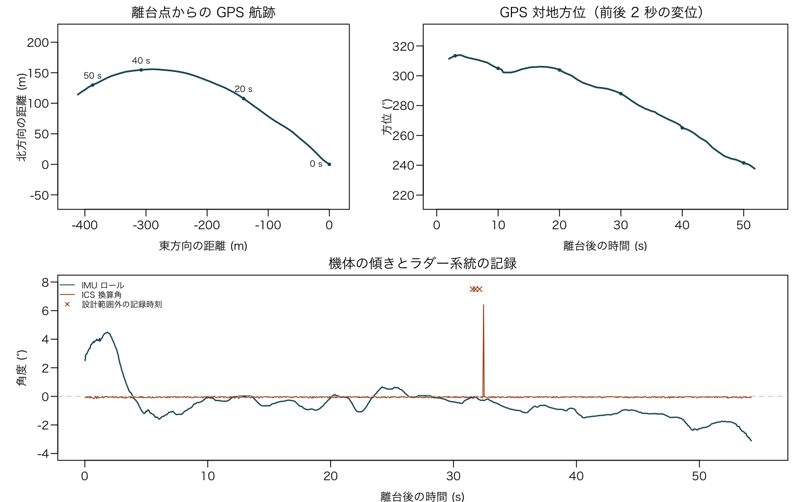

# 竜海の左右操舵と2025年大会の航跡

## パイロットは何を操作したか

竜海ではパイロットが人差し指で操縦桿を操作し、その電気信号でサーボモーターを駆動してラダーを動かす。三面図はこれをヨーの操縦系とし、垂直尾翼の設計操舵角を左右20°、面積を0.62 m²、モーメントアームを3.5 mとしている。20°は尾翼の舵角で、機体のバンク角に対する制限値ではない。ピッチは体重移動で操作し、水平尾翼の取付角は飛行前に固定する。ロールの安定性には主翼の二段上反を使うと鳥科が説明している。[鳥科・2025年大会三面図（操縦方法、垂直尾翼、パイロット姿勢）](https://torica-tus.com/wp-content/uploads/2025/11/03-【東京理科大学鳥人間サークル鳥科】-47-2025_鳥人間コンテスト三面図-1-レイアウト1.pdf)・[鳥科「竜海」機体解説](https://torica-tus.com/2025/11/14/2025/)

## 本番の操舵記録

鳥科の公開表の `Rudder` は `(data_ics_angle − 6465) × 135 / 4000` で計算される（`input!G2` 以下）。同じ時刻の `Roll`、`Yaw` は主IMUの値。25代電装の公開スケッチはICS通信を読んで記録している。操縦桿の操作開始と実際の尾翼の到達角を独立に計測した2系列は確認できない。以下の「舵角」はこのICS信号の換算値を指す。[大会集計表](https://github.com/torica-org/25th_Analysis/blob/115723c24ce9e64c07c79215770acc7559518d42/FlightLogs/2025_Tatsumi.xlsx)・[25代電装スケッチ](https://github.com/torica-org/TORICA_Sim_Controller/blob/17dc96174cbaa3801ec5b2d3bc28f371bf45a3d0/Documents/25th_Denso/25th_Main1_denso.ino#L315-L319)・[ICSの位置指令と位置返信](https://kondo-robot.com/faq/krs_tutorial_py1)

離台時刻をログの3.9秒と置き、着水タグ58.130秒までの972点を集計した。968点は−0.169°から0°に収まり、実質的に中立だった。残る4点は離台後31.558・31.780・32.111秒の892.0125°（生値32895）と、32.442秒の6.4125°（生値6655）。前者は設計範囲外で、後者も前後に続く入力がない。6.4125°は物理的に可能な角度だが、この1サンプルでパイロットの意図や舵を切った時間を決めることはできない。[加工済みCSV](https://github.com/torica-org/25th_Analysis/blob/115723c24ce9e64c07c79215770acc7559518d42/flightDataPlot/src/2025_Tatsumi.csv)・[ICS生値を含む元ログ](https://github.com/torica-org/25th_Analysis/blob/115723c24ce9e64c07c79215770acc7559518d42/getWindVector/src/2025FlightLog.csv)

後続の九州大学の鈴嶋選手は、桟橋から竜海を後方視し、離台直後は右へ、低高度に入ってから左へ流れたと記録した。鳥科のパイロットの話として、本番ではラダーを使わなかったとも記している。前者は当日の目撃、後者は本人の発言を紹介した記述で、ログがほぼ中立だったことと整合する。[九州大学・鈴嶋選手の大会記録「鳥科（九大は桟橋中央）」](https://q-birdman.lix.jp/2025/08/05/鳥人間コンテスト2025を振り返ってver-パイロット/)

## モデル値と座標の読み方

- 竜海用の訓練シミュレーターでは最大ラダー指令 `drMAX` は10°。横滑り角、ロール角速度、ヨー角速度、ラダー角から横力とロール・ヨーモーメントを計算する。これは別途試せる計算モデルで、大会機の設計舵角や実測した応答時間とは区別する。[竜海用パラメーター](https://github.com/Kimama-2005/torica-sim2025-unity/blob/3bddd0106db223ed864c4938ef3194a9af173682/TORICA%20sim%20Develop/Assets/Tatsumi.csv)・[訓練モデルの横力とモーメント](https://github.com/Kimama-2005/torica-sim2025-unity/blob/3bddd0106db223ed864c4938ef3194a9af173682/TORICA%20sim%20Develop/Assets/Script/Plane/AerodynamicCalculator.cs#L411-L426)
- 鳥科の風解析は北から時計回りを正、右バンクを正と定義し、主IMUの `Yaw` を `325° − Yaw` に変換している。絶対方位の換算にはこの基準が含まれる。GPSの進行方位は緯度・経度から独立に求められ、機首方位とは風や横滑りで差が生じる。[鳥科の風ベクトル解析](https://github.com/torica-org/25th_Analysis/blob/115723c24ce9e64c07c79215770acc7559518d42/getWindVector/getWindFromFlightData.m)

## 映像とログの時刻をそろえる

離台は公式映像の2:03〜2:04、着水は2:58〜2:59に見える。ログは既存の離台推定3.9秒（約±0.2秒）を原点とし、チームの着水タグ58.130秒までの54.230秒を空中区間とした。映像と機上時計に共通の時刻印はない。下の対応は離台を基準にした秒単位の目安。計算には映像の再生時間を使っていない。[離台映像](https://www.youtube.com/watch?v=brdhsnknoKs&t=123s)・[着水映像](https://www.youtube.com/watch?v=brdhsnknoKs&t=178s)・[離台推定の根拠](flight-validation.md)

| 公式映像 | おおよその離台後 | 映像で確認できること |
|---|---:|---|
| [2:31](https://www.youtube.com/watch?v=brdhsnknoKs&t=151s) | 27〜28秒 | 発進台・伴走艇を含む広い空撮。GPSで進路が左へ変わっている区間。遠景で操縦桿や舵面の変位は読めない。 |
| [2:36](https://www.youtube.com/watch?v=brdhsnknoKs&t=156s) | 32〜33秒 | 岸を背景にした側方のカットで垂直尾翼が見える。ICS換算角の孤立値付近だが、撮影角・同期精度とも約0.06秒の舵角変化を裏付けるものではない。 |
| [2:51](https://www.youtube.com/watch?v=brdhsnknoKs&t=171s) | 47〜48秒 | 湖面すれすれの機体を側方から追走。湖面の反射は見えるが、この投影から地理的な進路方位や指の入力時刻は測れない。 |

## 対地進路の変化

飛行中の緯度・経度が更新された最初の行を採用した。GPS位置の更新間隔の中央値は0.986秒、最後の更新は離台後53.844秒。緯度・経度を離台地点付近の WGS84 局所平面に写し、観測点の間だけを線形補間した。表の各時刻の方位は前後2秒の変位から求めた北基準・時計回り正の対地方位。区間両端の方位差を経過秒数で割った。機首のヨー角速度・風に対する旋回率とは区別する。[大会GPS・姿勢・舵角のCSV](https://github.com/torica-org/25th_Analysis/blob/115723c24ce9e64c07c79215770acc7559518d42/flightDataPlot/src/2025_Tatsumi.csv)

| 離台後 | 実機GPSの始点 → 終点方位 | 平均方位変化率 | 方位を求める窓を2・4・6秒に変えた範囲 |
|---|---|---:|---:|
| 3〜10秒 | 313.4° → 305.0° | −1.21°/秒 | −1.72〜−0.95°/秒 |
| 10〜20秒 | 305.0° → 303.9° | −0.11°/秒 | −0.17〜+0.11°/秒 |
| 20〜30秒 | 303.9° → 288.0° | −1.59°/秒 | −1.61〜−1.55°/秒 |
| 30〜40秒 | 288.0° → 265.0° | −2.30°/秒 | −2.37〜−2.06°/秒 |
| 40〜50秒 | 265.0° → 241.6° | −2.35°/秒 | −2.56〜−2.11°/秒 |

10〜20秒は窓を変えると符号も変わる。20〜50秒はどの窓でも左向きで、30〜50秒に対地進路が約46°変わった。各範囲は平滑化に対する感度で、測位誤差の信頼区間ではない。初期の右へのずれは発進台に対する位置・進路の話で、右への角速度がずっと続いたという意味ではない。[集計コード](steering-analysis.R)・[大会当日の後方からの目撃記録](https://q-birdman.lix.jp/2025/08/05/鳥人間コンテスト2025を振り返ってver-パイロット/)



空中区間の主IMUのロールは −3.11°〜+4.49°、横滑り角の記録は −13.97°〜+13.63°。傾き・横滑り・風による偏流は別の量であり、GPS進路が左へ曲がった原因をこの1飛行だけで横風やラダーに割り当てることはできない。姿勢・ICSの行間隔の中央値は0.056秒だが、入出力を対応づけられる持続的な操舵がなく、これを応答時間の精度とはみなせない。[元の時系列](https://github.com/torica-org/25th_Analysis/blob/115723c24ce9e64c07c79215770acc7559518d42/flightDataPlot/src/2025_Tatsumi.csv)

## 実装と比較した結果

比較用基準機を翼幅25.1 m・取付角3.2°、基準風、標準押力、台端で手放し、発進方向0°で計算した。記録した位置を実機と同じ4秒幅の弦にし、台の仮定方位295°を足した。離台後20、30、40、50秒の値はそれぞれ302.3°、288.2°、267.9°、247.0°。GPSとの差は −1.6°、+0.1°、+2.8°、+5.4°。終盤の左への曲がり方を比較用航跡に反映できるが、基準機のコース自体がこの大会のGPSを使っているため、これは同一飛行への適合度である。[基準コース](race2025.js)・[飛行計算](flight.js)

変更前の手動モデルでは左右入力からバンク±22°へ時定数0.85秒で追従させている。対気速度10.5 m/sで22°を保つ場合の式上の定常機首旋回率は約21.6°/秒。これは全入力に対する仮想値で、大会のほぼ中立時の対地進路変化率との比から操舵ゲインを逆算できない。変更前の無入力・標準条件の手動飛行は方位一定で約32.68秒で着水するため、そのままでは当日の50秒時点との比較もできない。[手動飛行の式](flight.js)・[公開ログ](https://github.com/torica-org/25th_Analysis/blob/115723c24ce9e64c07c79215770acc7559518d42/flightDataPlot/src/2025_Tatsumi.csv)

### 手動モデルへの反映

左右キーの全入力を竜海用訓練設定のラダー角10°に対応させた。UIでは右舵を正とし、空力計算では原典の符号に従い右舵を負の `dr` とする。ラダーと横滑りは度単位、ロール・ヨー角速度はラジアン毎秒に翼幅を対気速度の2倍で割った値（`b/(2V)`）を掛けて無次元化する。12個の安定微係数で横力係数・ロール係数・ヨー係数を求め、横力は動圧×翼面積、モーメントはさらに翼幅を掛けて次元化する。機体の角速度と水平速度を120 Hzで積分するため、横滑りがあると機首方位と対地進路が異なる。[訓練モデルの係数](https://github.com/Kimama-2005/torica-sim2025-unity/blob/3bddd0106db223ed864c4938ef3194a9af173682/TORICA%20sim%20Develop/Assets/Tatsumi.csv)・[手動モデル](flight.js)

実装ではロールとヨーの慣性に訓練モデルの主慣性モーメント993.022、1028.254 kg·m²を使い、機体軸に沿う対角テンソルで近似する。ピッチ慣性は既存の51 kg·m²。空力係数は基準機の値を共用し、翼幅を変えると翼面積・腕長・角速度の無次元化が変わる。サーボの時間遅れは設けず、舵を離した瞬間に指令・表示とも中立とする。3Dの回転軸は尾翼金具付近の近似位置。比較用のGPSコースは従来どおりで、上の大会ログから操舵ゲインや時定数を同定したものではない。[竜海の機体と3D外形](aircraft.js)・[比較用コース](race2025.js)

## 再計算

上記コミットの `flightDataPlot/src/2025_Tatsumi.csv`（Git blob `24ce501f21a25c5ef42e5b71acae320862691096`）を使う。次のコマンドはR標準機能で集計し、図を再生成する。

```sh
Rscript steering-analysis.R 2025_Tatsumi.csv steering-observations.png
```
